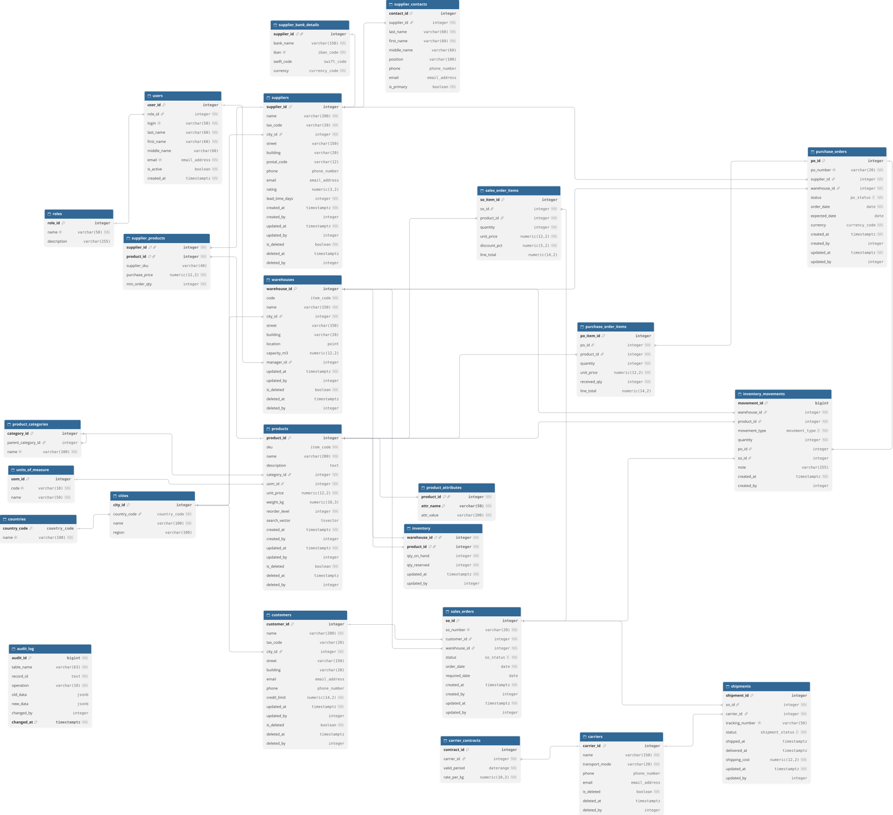

# Система управління ланцюгами постачання - ЛР2: NoSQL



Ця гілка - ЛР2, побудована на основі [ЛР1](https://github.com/amiadesu/db_lab1_scm) (гілка `main`).

1. Каталог товарів винесено в MongoDB (картка товару, яка в ЛР1 складалася з 6 таблиць, тепер - один документ).
2. Мережа постачання в Neo4j (постачальники, товари, категорії, склади й замовлення як граф).

## Предметна область

База даних призначена для торгівельної компанії, яка закуповує товари в постачальників, зберігає їх на кількох складах і продає клієнтам з доставкою через перевізників. Вона дозволяє в одному місці:

- вести довідники постачальників, товарів, складів, клієнтів і перевізників;
- проводити замовлення постачальникам від чернетки до приймання товару на склад;
- бачити актуальні залишки по кожному складу і знати, що час дозамовити;
- резервувати товар під замовлення клієнтів і відвантажувати його;
- зберігати історію змін: хто, коли і що змінив, а видалені записи не втрачати (soft delete).

<details>
<summary>Таблиці, зв'язки та вимоги з ЛР1</summary>

Таблиці з soft delete: `suppliers`, `products`, `warehouses`, `customers`, `carriers`.

Поля `updated_at`/`updated_by` (а в більшості з них і `created_at`/`created_by`) мають `suppliers`, `products`, `warehouses`, `customers`, `inventory`, `purchase_orders`, `sales_orders`, `shipments`.

Усі поля `*_by` посилаються на `users`.

### Системні таблиці

| Таблиця | Призначення | Зв'язки |
|---|---|---|
| `roles` | ролі користувачів | 1 → N `users` |
| `users` | користувачі системи | N → 1 `roles`; 1 → N `warehouses` (менеджер складу) |
| `countries` | країни (код ISO) | 1 → N `cities` |
| `cities` | міста з регіоном | N → 1 `countries`; 1 → N `suppliers`, `customers`, `warehouses` |
| `units_of_measure` | одиниці виміру | 1 → N `products` |
| `product_categories` | дерево категорій товарів | сама на себе через `parent_category_id`; 1 → N `products` |

### Постачання

| Таблиця | Призначення | Зв'язки |
|---|---|---|
| `suppliers` | постачальники | N → 1 `cities`; 1 → 1 `supplier_bank_details`; 1 → N `supplier_contacts`, `purchase_orders`; N ↔ M `products` через `supplier_products` |
| `supplier_bank_details` | банківські реквізити постачальника | 1 → 1 `suppliers` (первинний ключ є і зовнішнім) |
| `supplier_contacts` | контактні особи, одна з них основна | N → 1 `suppliers` |
| `supplier_products` | прайс: ціна закупівлі та мінімальна партія | N → 1 `suppliers`, N → 1 `products` |
| `purchase_orders` | замовлення постачальнику | N → 1 `suppliers`, N → 1 `warehouses` (склад приймання); 1 → N `purchase_order_items` |
| `purchase_order_items` | рядки замовлення постачальнику | N → 1 `purchase_orders` (видаляються разом із замовленням), N → 1 `products` |

### Склад

| Таблиця | Призначення | Зв'язки |
|---|---|---|
| `products` | товари | N → 1 `product_categories`, N → 1 `units_of_measure`; 1 → N `product_attributes` |
| `product_attributes` | довільні характеристики товару "назва - значення" | N → 1 `products` |
| `warehouses` | склади з координатами | N → 1 `cities`, N → 1 `users` (менеджер) |
| `inventory` | залишок і резерв товару на складі | N → 1 `warehouses`, N → 1 `products` (ключ - пара склад + товар) |
| `inventory_movements` | рух товару: приймання, відвантаження, коригування | N → 1 `warehouses`, `products`; приймання посилається на `purchase_orders`, відвантаження на `sales_orders` |

### Продажі та доставка

| Таблиця | Призначення | Зв'язки |
|---|---|---|
| `customers` | клієнти | N → 1 `cities`; 1 → N `sales_orders` |
| `sales_orders` | замовлення клієнта | N → 1 `customers`, N → 1 `warehouses` (склад відвантаження); 1 → N `sales_order_items`, `shipments` |
| `sales_order_items` | рядки замовлення клієнта зі знижкою | N → 1 `sales_orders` (видаляються разом із замовленням), N → 1 `products` |
| `carriers` | перевізники та вид транспорту | 1 → N `carrier_contracts`, `shipments` |
| `carrier_contracts` | договори з тарифом за кг і періодом дії | N → 1 `carriers` |
| `shipments` | відвантаження з номером відстеження | N → 1 `sales_orders`, N → 1 `carriers` |

### Аудит

| Таблиця | Призначення | Зв'язки |
|---|---|---|
| `audit_log` | журнал змін зі старими й новими значеннями в JSONB, секціонований за роками | N → 1 `users` (хто змінив); на інші таблиці посилається за назвою та id запису, без зовнішнього ключа |

### Вимоги до системи

**Користувачі та доступ**
- Кожен користувач має одну роль (адміністратор, закупівельник, комірник, менеджер з продажу).
- Для основних даних фіксується, хто і коли їх створив та востаннє змінив.
- Усі зміни постачальників, товарів, клієнтів, складів, замовлень і відвантажень пишуться в журнал аудиту зі старими та новими значеннями.

**Постачальники**
- Постачальник має назву, податковий код, адресу (місто → країна), контакти, рейтинг і типовий термін постачання.
- Для українських постачальників і клієнтів перевіряється контрольна цифра ЄДРПОУ / РНОКПП.
- У постачальника можуть бути банківські реквізити (IBAN перевіряється за ISO 13616) і кілька контактних осіб, з яких одна основна.
- Постачальник має прайс-лист: ціна закупівлі та мінімальна партія для кожного товару.
- Постачальника не можна видалити фізично (soft delete) і не можна видалити, поки в нього є незакриті замовлення. Видаленого постачальника можна відновити.

**Товари та склади**
- Товар має унікальний серед активних товарів артикул, категорію (категорії утворюють дерево без циклів), одиницю виміру, ціну та рівень дозамовлення.
- Довільні характеристики товару зберігаються як пари "назва - значення".
- Товар з ненульовим залишком не можна видалити. Видалений товар можна відновити.
- Залишки ведуться по кожному складу окремо: фізична кількість і зарезервована під замовлення клієнтів.
- Залишок змінюється лише через рух товару: приймання, відвантаження або ручне коригування з обов'язковим поясненням.
- Система підказує, що дозамовити і в якого постачальника, коли вільний залишок падає нижче рівня дозамовлення.

**Закупівлі**
- Замовлення постачальнику проходить статуси: чернетка → затверджене → відправлене → частково / повністю отримане, або скасоване до приймання.
- Рядки замовлення можна змінювати лише в чернетці. Ціна за замовчуванням береться з прайсу постачальника, кількість не менша за мінімальну партію.
- Товар можна приймати частинами, при цьому ведеться облік недоотриманої кількості. Прийняти більше, ніж залишилось, не можна.
- Для постачальника рахується частка замовлень, отриманих вчасно.

**Продажі та доставка**
- Замовлення клієнта проходить статуси: нове → підтверджене → комплектується → відвантажене → доставлене, або скасоване до відвантаження.
- Замовлення клієнта резервує товар на складі. Повторне додавання того самого товару збільшує кількість у рядку. Скасування замовлення знімає резерв.
- Відвантаження списує товар зі складу і передає замовлення перевізнику з номером відстеження. Доставка закриває замовлення, а повернене відвантаження повертає товар на склад.
- Клієнтів, склади й перевізників так само не видаляють фізично (soft delete), і їх можна відновити. Клієнта не можна видалити з невідвантаженими замовленнями, склад - із залишками чи незакритими замовленнями, перевізника - з відвантаженнями в дорозі.
- Договори з перевізником мають період дії й тариф, періоди одного перевізника не перетинаються.

</details>

## П2) Враховуючи вашу предметну область, чи буде ефективніше винести частину даних в іншу базу? Навести аргументи

Є сенс винести каталог товарів (товар + характеристики + категорія + одиниця виміру + пропозиції постачальників):

- Характеристики в ЛР1 зберігаються як Entity-Attribute-Values (EAV; `product_attributes`: назва - значення), через що фільтр за кількома характеристиками потребує окремого JOIN на кожну з них, а всі значення зберігаються рядками і втрачають тип. У документі MongoDB характеристики - звичайні типізовані поля.
- Картка товару збирається з 6 таблиць, а читається набагато частіше, ніж змінюється.

## Що зроблено

### Каталог у MongoDB (П3)

`nosql/migrate.py` читає каталог з PostgreSQL і складає з шести таблиць один документ на товар:

```js
{
  _id: 2, // products.product_id
  sku: "EL-SSD-512", name: "SSD накопичувач 512 ГБ",
  category: { id: 4, name: "Комплектуючі", // product_categories
              path: ["Електроніка", "Комплектуючі"], pathIds: [1, 4] },
  uom: { code: "pcs", name: "штука" }, // units_of_measure
  priceMinor: 189900, // ціна в копійках
  attributes: { interface: "NVMe", capacity_gb: 512 }, // product_attributes
  offers: [ { supplierId: 1, supplierName: "ТОВ «ТехноПостач»", // supplier_products + suppliers
              purchasePriceMinor: 145000, minOrderQty: 1 } ],
  isDeleted: false
}
```

### Те саме в SQL (П4)

SQL-сторона - та сама схема `scm` з ЛР1, без окремих таблиць. Додано лише `sql/08_lab2_indexes.sql` - індекси, еквівалентні індексам MongoDB, щоб порівняння швидкодії у П5 було чесним (інакше MongoDB вигравала б через кращий індекс, а не через модель даних). SQL-запити кожної операції лежать у `nosql/bench.py`, а зміна характеристики викликає процедуру ЛР1 `sp_product_set_attribute`.

### Порівняння швидкодії (П5)

`nosql/generate.py` перевстановлює схему ЛР1 і генерує товари: 64 категорії, у кожної свій набір характеристик, 1–4 пропозиції від постачальників, генерація детермінована.

`nosql/bench.py` виконує сім операцій в обох базах:

| Тест | Операція | Що перевіряє |
|---|---|---|
| T1 | Картка товару за артикулом | 6 таблиць через JOIN проти одного документа |
| T2 | 20 найдешевших товарів підкатегорії | рекурсивний обхід дерева проти `pathIds` |
| T3 | Підкатегорія + 2 характеристики + ціна | self-join в EAV проти звичайних полів |
| T4 | Фасети категорії | групування |
| T5 | Вставка товару з характеристиками і пропозиціями | ~10 рядків з перевіркою зовнішніх ключів проти одного документа |
| T6 | Зміна однієї характеристики | точкове оновлення |
| T7 | Перейменування постачальника | ціна дублювання |

Щоб порівняння було чесним:

- Перед вимірюваннями `bench verify` перевіряє, що обидві бази повертають однакові результати.
- Обидві бази отримують однаковий список параметрів.
- І SQL, і MongoDB роблять рівно одне звернення до бази даних.
- MongoDB підтверджує запис лише після запису в журнал на диск (`j: true`), як COMMIT у PostgreSQL.
- Аудит ЛР1 на час тестів вимикається, бо в MongoDB його немає.
- Перед вимірюванням база прогрівається.
- Три обсяги: 10 тис., 100 тис., 1 млн товарів.

### Мережа постачання в Neo4j (П6)

`graph/load_graph.py` переносить дані з PostgreSQL у граф:

```
(:Supplier)-[:SUPPLIES {price, minQty}]->(:Product)-[:IN_CATEGORY]->(:Category)-[:CHILD_OF]->(:Category)
(:Warehouse)-[:STOCKS {onHand, reserved}]->(:Product)
(:Customer)-[:PLACED]->(:SalesOrder)-[:CONTAINS {qty, price}]->(:Product)
(:SalesOrder)-[:SHIPS_FROM]->(:Warehouse)
```

`graph/queries.cypher` - базові запити: створення, читання, оновлення, видалення, `MERGE`, сортування і агрегація, обходи графа, `PROFILE` (профайлер).

## Запуск

Потрібні PostgreSQL 15+, Podman або Docker і Python 3.13+.

```bash
# 1. MongoDB і Neo4j
podman compose up -d

# 2. Залежності
pip install -r requirements.txt

# 3. Окрема база для ЛР2
sudo -u postgres createdb db_lab2_scm
export PG_DSN="dbname=db_lab2_scm user=postgres password=password host=localhost"

# 4. Генерація даних, міграція, порівняння
python -m nosql.generate --n 100000 # схема ЛР1 + 100 тис. товарів
python -m nosql.migrate # каталог -> MongoDB
python -m nosql.bench verify # перевірка однакових відповідей
python -m nosql.bench run # вимірювання швидкодії

# 5. Граф
python -m graph.load_graph
```

Крок 4 повторюються для `--n 10000`, `--n 100000` і `--n 1000000`.

**Де дивитися результати:**

- `results/summary.csv` - затримки (медіана, p95, p99) й операцій/с для кожного тесту
- `results/chart_<N>.png` - графік
- `results/sizes.txt` - розмір даних та індексів в обох базах
- `results/explain/` - плани виконання запитів

**Де дивитися дані:**

- **PostgreSQL** - база `db_lab2_scm`, схема `scm`
- **MongoDB** - `podman exec -it lab2-mongo mongosh scm_catalog`
- **Neo4j** - http://localhost:7474 (логін `neo4j`, пароль `lab2-password`), запити з `graph/queries.cypher` виконуються по одному

## Структура

| Файл | Вміст |
|---|---|
| `sql/01`–`07` | схема, функції, тригери, розрізи, процедури, індекси, початкові дані (ЛР1) |
| `sql/08_lab2_indexes.sql` | індекси під запити каталогу, рівноцінні індексам MongoDB |
| `app/` | Repository + Unit of Work на psycopg2 (ЛР1) |
| `diagram/` | схема в DBML і SVG (ЛР1) |
| `docker-compose.yml` | MongoDB і Neo4j |
| `nosql/config.py` | налаштування підключень (змінні середовища) |
| `nosql/generate.py` | генерація каталогу |
| `nosql/migrate.py` | винесення каталогу в MongoDB |
| `nosql/bench.py` | порівняння швидкодії |
| `graph/load_graph.py` | завантаження графа в Neo4j |
| `graph/queries.cypher` | запити Cypher |

## Технології

PostgreSQL 15+ (`pg_trgm`, `btree_gist`), MongoDB 8, Neo4j 5, Python 3.13+ (`psycopg2`, `pymongo`, `neo4j`, `matplotlib`).